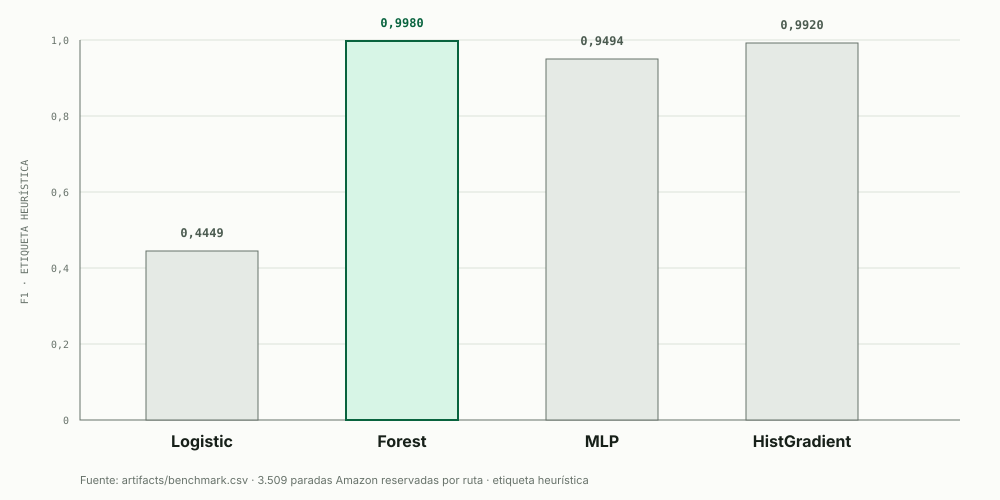

# Semana 11 — Benchmark de cuatro modelos sobre paradas Amazon

**Fecha:** 14 de octubre de 2026. **Proyecto:** Órbita · IA logística.  
**Pregunta académica:** ¿qué familia aprende mejor la etiqueta de **riesgo heurístico** contenida en las paradas Amazon Last Mile del proyecto, bajo una prueba reservada por rutas?

## Procedencia y alcance

El benchmark principal usa `data/amazon_pedidos.csv`: **14.411 paradas importadas**, de las cuales **100 son estaciones** sin entrega y se excluyen por elegibilidad. Quedan **14.311 paradas `Dropoff`**, distribuidas en 100 rutas. Hay **1.023 positivos** (`retrasado_estimado=1`, 7,15 %). No se usan las 800 filas sintéticas de `data/pedidos.csv` —que permanecen para prácticas anteriores— ni las 200 imágenes del piloto visual. El parecido entre «200 imágenes» y el antiguo «200 test» sintético era una coincidencia, no una relación de datos.

**Limitación decisiva:** `retrasado_estimado` **no es un retraso observado**. `src/datos/amazon.py` la calculó mediante tres condiciones (`ventana <180 min` junto con `secuencia_real >40`; servicio planificado >150 s y volumen >0,03 m³; o distancia >15 km y al menos 3 paquetes). En este CSV concreto, **las dos últimas condiciones reproducen los 1.023 positivos sin error**: la primera no aporta casos positivos exclusivos. Por tanto, un score casi perfecto mide sobre todo **aprendizaje de una regla conocida**, no capacidad de anticipar demoras reales. Esta verificación tiene prueba automatizada. En el Corte 3 queda pendiente obtener hora prometida/efectiva y definir una etiqueta observada.

## Protocolo de evaluación

1. Se mantienen los cuatro modelos acordados: `LogisticRegression`, `RandomForestClassifier`, `MLPClassifier` (familias de la guía) y `HistGradientBoostingClassifier` (retador tabular). El caso `load_digits` de la guía no se copia.
2. Variables disponibles antes del despacho: distancia al depósito, número de paquetes, volumen total, tiempo **planificado** de servicio, duración de ventana, capacidad del vehículo y bandera de ventana. Se excluyen IDs, `route_id`, estación, zona, fecha/hora, coordenadas y especialmente `secuencia_real` del vector `X`. `route_id` solo agrupa la partición. Excluir la secuencia evita usar una variable posterior, pero **no transforma** la etiqueta heurística en verdad observada.
3. `StratifiedGroupKFold(4)` con semilla `20260828` reserva su primer pliegue: **10.802 train / 3.509 test** (75,48 % / 24,52 %), con **76 / 24 rutas disjuntas** y 251 positivos en test. La proporción de clase se conserva aproximadamente; no se sacrifica la separación por ruta para obtener exactamente 25 % de filas.
4. Dentro de train, cinco pliegues estratificados y agrupados por ruta generan probabilidades fuera de pliegue. Cada `Pipeline` aprende `StandardScaler` solo en su train; las binarias pasan sin transformar. Se selecciona umbral por F2 en la rejilla 0,025–0,75 sin mirar test. Después se ajusta con todo train y se evalúa **una vez** el test reservado.
5. Se informa accuracy, precisión, recall, F1 y average precision de la clase positiva, FN/FP, ajuste final e inferencia por lote. Los tiempos dependen del equipo y **no** son latencia HTTP ni E2E de la Torre. `artifacts/semana11_benchmark.json` guarda semilla, rutas, variables, versiones, matrices y SHA-256 de código/datos/CSV; la API rechaza evidencia obsoleta.

La [validación agrupada de scikit-learn](https://scikit-learn.org/stable/modules/cross_validation.html#cross-validation-iterators-for-grouped-data) evita que una misma ruta aporte paradas a ambos lados; el [pipeline](https://scikit-learn.org/stable/common_pitfalls.html#data-leakage) evita aprender transformaciones desde test. Estos controles no corrigen la naturaleza heurística del objetivo.

## Resultados en las 3.509 paradas reservadas

| Modelo | Accuracy | Precision | Recall | F1 | Average precision | FN | FP | Umbral F2 |
|---|---:|---:|---:|---:|---:|---:|---:|---:|
| Logistic | 0,8606 | 0,3111 | 0,7809 | 0,4449 | 0,4413 | 55 | 434 | 0,10 |
| **Forest** | **0,9997** | **0,9960** | **1,0000** | **0,9980** | **1,0000** | **0** | **1** | 0,30 |
| MLP | 0,9926 | 0,9278 | 0,9721 | 0,9494 | 0,9943 | 7 | 19 | 0,15 |
| Hist | 0,9989 | 0,9920 | 0,9920 | 0,9920 | 0,9999 | 2 | 2 | 0,60 |

La matriz de Forest es `[[3257, 1], [0, 251]]`; la de Hist, `[[3256, 2], [2, 249]]` (filas: realidad `[0,1]`, columnas: predicción `[0,1]`). La clase positiva solo ocupa 7,15 % del conjunto elegible: predecir siempre cero daría aproximadamente **92,85 % de accuracy** en test y recall cero. Por eso accuracy aislada no decide. `forest` gana este protocolo; `hist` queda muy cerca. La enorme diferencia frente a Logistic es coherente con una etiqueta definida por **umbrales y conjunciones**, que los árboles reproducen con facilidad. **No** es evidencia de que Forest o Hist predigan mejor los retrasos reales de un cliente.

### Diagrama de resultados · diagram-design



*Figura 1. F1 en escala 0–1. Si tu visor no muestra el SVG, abre el [diagrama Órbita en HTML](figuras/semana11-f1-diagram-design.html) o el [SVG directamente](figuras/semana11-f1-diagram-design.svg). Los valores proceden del CSV versionado, no de las imágenes.*

## Interpretación para el proyecto y el Corte 3

**Resultado del laboratorio:** Forest es el mejor **imitador de la etiqueta heurística** bajo este split. **Decisión de arquitectura:** no sustituir automáticamente la regla explícita que generó la etiqueta por un modelo que la copia casi perfectamente. La regla es auditable y, en estos datos, reproduce el objetivo exactamente; el modelo sirve como comparación académica y eventual retador, no como prueba de valor operativo añadido. Ninguna de estas señales autoriza despacho, cuarentena o rechazo sin reglas duras y revisión humana.

El [ADR-011](semana11_adr.md) separa este ganador experimental de la decisión de producto. Las dudas sobre definición de retraso real, variable disponible al momento de predicción, costo FN/FP, generalización temporal y política de imágenes están en el [plan del Corte 3](../docs/decision-tecnologica-y-plan-torre-control.md). La Torre seguirá creciendo por semanas; este benchmark **no** la declara construida.

## Reproducción

```bash
python -m src.semana11_benchmark
python -m pytest -q tests/test_semana11_benchmark.py
cd dashboard && pnpm test
```

Artefactos: `artifacts/benchmark.csv`, `artifacts/semana11_benchmark.json`, este informe y el diagrama interactivo archify de Órbita. `GET /api/semana11/benchmark` solo sirve evidencia precalculada. La evaluación usa un pliegue reservado y cinco de validación; no incluye prueba temporal, intervalos de confianza ni datos de retraso observados. Su aplicación fuera de la simulación exige una nueva etiqueta y nueva evaluación.
